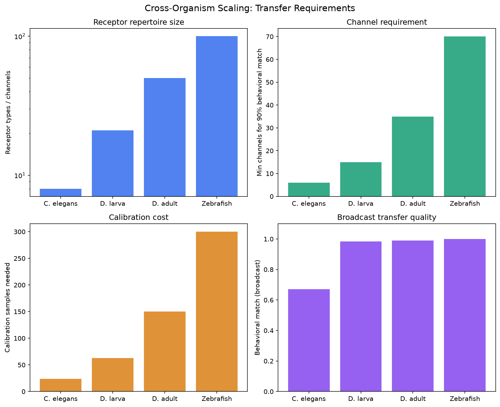
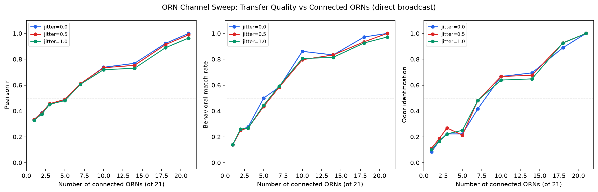
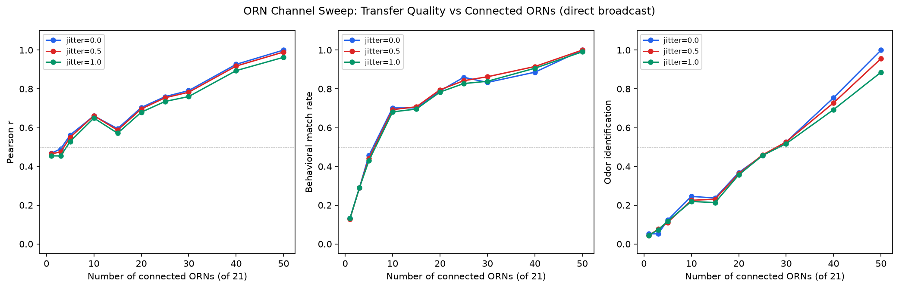
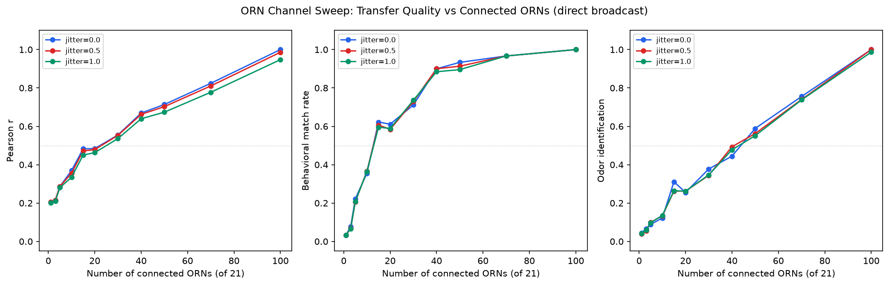
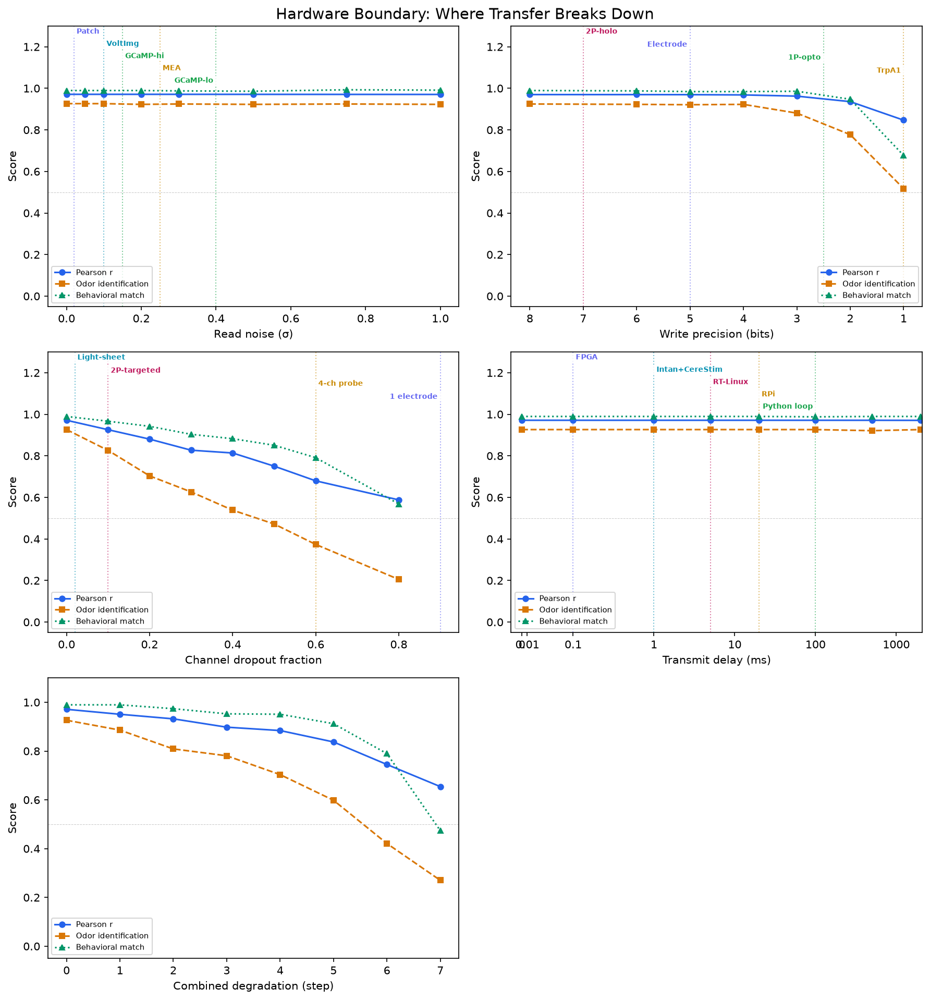
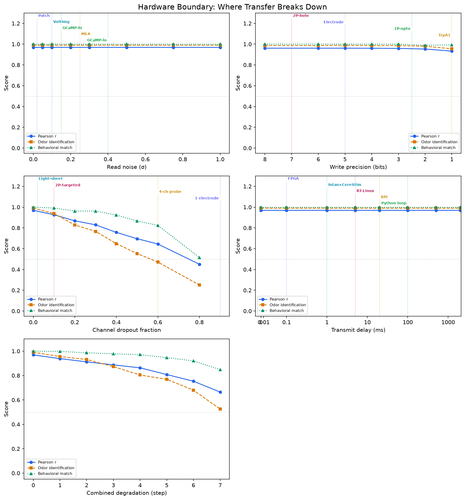
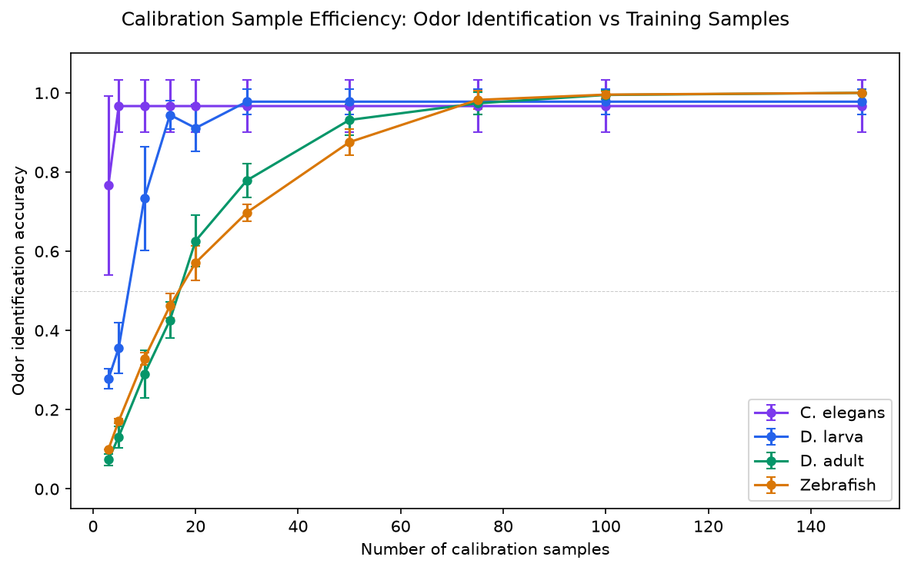
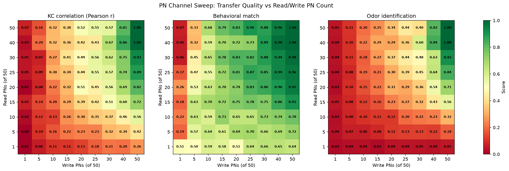
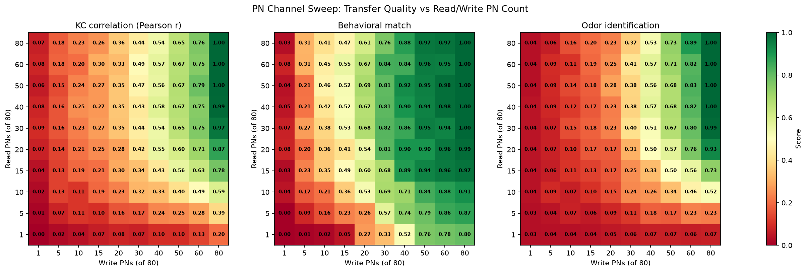

# Connectome-Based Simulation of Inter-Brain Olfactory Signal Transfer: Requirements Across Four Model Organisms

**Justin Black**

*Independent researcher*

Correspondence: justin.a.black@gmail.com

## Abstract

We present a computational framework for estimating the hardware and software requirements of transferring olfactory signals between two simulated brains. Using connectome-derived neural circuit models of four organisms — *C. elegans*, *Drosophila* larva, adult *Drosophila*, and zebrafish — we systematically vary channel count, hardware impairments, calibration strategy, and inter-individual neural variability to identify the conditions under which a receiver brain reproduces the sender's odor-evoked behavioral response. Our key finding is that bottleneck architecture, not brain size, determines transfer requirements: N-way odor identification accuracy at 50% channel connectivity is 67% for the 21-channel larva, 59% for the 100-channel zebrafish, and 46% for the 50-channel adult fly — a ranking that tracks architectural complexity (convergence ratio, expansion factor, lateral inhibition) rather than receptor count. Hardware boundary analysis reveals that read noise and channel dropout are the binding constraints across all organisms, while write precision above 4 bits and transmit delay below 100 ms contribute minimally. These results establish quantitative lower bounds on inter-brain olfactory transfer and demonstrate that the critical engineering challenge is matching the write site to the receiver's bottleneck architecture, not scaling channel count to match receptor number.

## 1. Introduction

Brain-to-brain communication of sensory information is a long-standing goal at the intersection of neuroscience and neural engineering. While brain-computer interfaces have made substantial progress in decoding motor intentions and delivering sensory feedback (Lebedev & Nicolelis, 2017), direct transfer of a complete sensory representation from one brain to another remains largely unexplored in quantitative terms. The fundamental question — how many channels, at what precision, connected where — has no established answer even for the simplest nervous systems.

We address this gap through simulation. Rather than building hardware, we construct connectome-based neural circuit models and ask: under what conditions does a receiver brain, which has never been exposed to an odor, produce the same behavioral response as a sender brain that detected it?

We chose olfaction for three reasons. First, the olfactory pathway in insects and vertebrates contains a well-characterized bottleneck — the glomerular layer — where receptor diversity is compressed into a much smaller number of channels before expansion into downstream associative areas. This bottleneck is a natural candidate for a write site. Second, connectome data is available for organisms spanning three orders of magnitude in receptor count, enabling a scaling analysis. Third, the behavioral readout (approach or avoidance) provides an unambiguous ground truth.

Our four organisms span a range of architectures:

| Organism | Receptor types | Glomeruli | Signal mode | Key feature |
|----------|---------------|-----------|-------------|-------------|
| *C. elegans* | 8 | — | Graded | No bottleneck; multiplexed receptors |
| *Drosophila* larva | 21 | 21 | Spiking | Clean 1:1 bottleneck |
| Adult *Drosophila* | 50 | 50 | Spiking | 50:1 convergence, 40× KC expansion |
| Zebrafish | 100 | 100 | Spiking | Recurrent lateral inhibition via granule cells |

Each organism is modeled as a feedforward (or recurrent, in the zebrafish case) neural circuit from receptor neurons through to behavioral output. Two instances — sender and receiver — are generated with controlled inter-individual variability, and a shared pipeline evaluates transfer quality under varying hardware and algorithmic conditions.

## 2. Methods

### 2.1 Neural Circuit Models

**C. elegans.** We implemented two worm models. The first is a hand-built circuit of the 8 olfactory receptor neurons (AWA, AWC_L, AWC_R, AWB, ADL, ASH) projecting through interneurons (AIY, AIB, AIA, AIZ) to command neurons (AVA, AVB). Synaptic weights are derived from the Cook et al. (2019) connectome via the `cect` library, with neurotransmitter signs from CeNGEN. The second uses the full connectome adjacency matrix. All worm neurons are modeled as graded, non-spiking units — consistent with the absence of voltage-gated sodium channels in *C. elegans*.

**Drosophila larva.** A spiking-rate model of 21 ORN types, each projecting to one of 21 projection neurons (PNs) via glomeruli, then expanding to 72 Kenyon cells (KCs) in the mushroom body via sparse random connectivity, and converging onto mushroom body output neurons (MBONs) that drive approach or avoidance. Odor response profiles are derived from Kreher et al. empty-neuron recordings.

**Adult Drosophila.** Scaled from the larval architecture: 50 ORN types (with 50:1 convergence onto PNs), 50 PNs, 2000 KCs with sparse random connectivity (connection probability ~0.1), and MBONs. Odor profiles are based on the DoOR database (Münch & Galizia, 2016) and Hallem & Carlson (2006).

**Zebrafish.** 100 OR types × 3 ORNs each → 100 glomeruli → 80 mitral cells → 200 granule cells (recurrent lateral inhibition) → 500 Dp (dorsal pallium) neurons → 2 output neurons. The granule cell layer implements lateral inhibition via a recurrent connectivity matrix with negative weights, iterated to convergence. This is the key architectural difference from insects: decorrelation occurs within the bulb before signals reach downstream areas. Odor profiles span 30 odorants with assigned valences.

### 2.2 Inter-Individual Variability

For each organism, we generate receiver variants from a canonical sender model by applying controlled perturbations:

1. **Synaptic weight jitter.** Each weight is multiplied by a factor drawn from a log-normal distribution with standard deviation proportional to the jitter scale parameter (0.0–1.5× biological coefficient of variation).
2. **Receptor gain variation.** Per-neuron sensitivity is scaled by a random factor.
3. **Threshold variation.** Behavioral decision thresholds are perturbed.

All variants must pass a sanity check: correct behavioral response to known attractants and repellents. Variants that fail are discarded.

### 2.3 Transfer Pipeline

The transfer pipeline consists of:

1. **Read.** The sender's receptor-layer activity is recorded. For PN/mitral channel sweeps, a subset of projection neurons is read instead.
2. **Hardware degradation.** Read noise (additive Gaussian, σ = 0–1.0), write precision (quantization to 1–8 bits), channel dropout (random fraction 0–0.8), and transmit delay (0–2000 ms, modeled as exponential decay toward baseline).
3. **Calibration.** A ridge regression transform is fitted on shared calibration odors (sender receptor activity → receiver receptor activity) and applied to held-out test odors. The direct broadcast baseline skips this step.
4. **Write.** The (optionally calibrated and degraded) signal is injected into the receiver's receptor layer (or PN/mitral layer), and the receiver's circuit propagates it to behavioral output.

### 2.4 Metrics

- **Behavioral match.** Fraction of trials where the receiver produces the sender's behavioral response (approach/avoidance).
- **Correlation.** Pearson r between transferred and natural receiver activity vectors (concatenated across all neurons and trials).
- **MSE.** Mean squared error between transferred and natural states.
- **RSA.** Spearman correlation between pairwise distance matrices of the transferred and natural odor representations.
- **Odor identification.** N-way nearest-centroid classification: for each transferred state, assign it to the odor whose natural-response centroid is nearest. This tests whether the transfer preserves enough structure to distinguish individual odors, not just valence categories. The number of classes varies by organism (2 odor types × 7 intensities = 14 for the worm; 12 odors × 3 intensities = 36 for the larva; 38 odors × 3 intensities = 114 for the adult fly; 30 odors × 3 intensities = 90 for the zebrafish).

We deliberately replaced an earlier 2-way attractive/repellent decoding metric with N-way odor identification after discovering that class imbalance inflated accuracy (e.g., 73.3% majority baseline for zebrafish with 22/30 odors sharing one valence). Odor identification is the more demanding and informative metric.

### 2.5 Experimental Design

For each organism, we run five experiment types:

1. **Broadcast sweep.** Direct receptor-to-receptor transfer across 7 jitter levels (0.0–1.5), 5 seeds per level.
2. **Calibration sweep.** Ridge regression vs. direct broadcast on held-out odors, same jitter levels.
3. **Channel sweep.** Transfer quality vs. number of connected ORNs (1 to all), at 3 jitter levels, with 3 random channel selections per count.
4. **Hardware boundary.** Four single-axis sweeps (noise, precision, dropout, delay) plus a combined sweep, at fixed jitter = 0.75.
5. **PN/mitral channel sweep.** 2D sweep of read and write projection neuron counts with calibration (larva, adult, zebrafish only).

Cross-organism scaling compares minimum channels for 90% behavioral match, calibration sample requirements, and broadcast quality.

## 3. Results

### 3.1 Broadcast Transfer Degrades Gracefully with Brain Difference

Direct broadcast (copying sender receptor activity to the receiver with no calibration) maintains high behavioral match even at substantial inter-individual variability:

| Organism | Behavioral match (jitter = 0.75) | Correlation (jitter = 0.75) | Odor ID (jitter = 0.75) |
|----------|--------------------------------|---------------------------|------------------------|
| *C. elegans* | 0.70 | 0.91 | 0.93 |
| *D.* larva | 0.98 | 0.96 | 0.96 |
| Adult *Drosophila* | 0.99 | 0.97 | 0.93 |
| Zebrafish | 1.00 | 0.97 | 0.99 |

The worm degrades fastest because its 8-dimensional receptor space provides little redundancy, and multiplexed receptor types mean individual variation in one neuron affects multiple odor dimensions. The fly and zebrafish bottleneck architectures are more robust: each receptor type occupies its own channel, so individual variation in one channel does not corrupt others.

*Figure 1. Cross-organism scaling comparison. Top left: receptor repertoire size. Top right: minimum channels for 90% behavioral match. Bottom left: calibration samples needed. Bottom right: broadcast behavioral match at jitter = 0.75.*

### 3.2 Calibration Achieves Near-Perfect Transfer

Ridge regression calibration achieves correlation > 0.999 and behavioral match = 1.0 across all organisms at all jitter levels tested, including jitter = 1.5 (1.5× biological coefficient of variation). This result means that calibration effectively eliminates the effect of inter-individual variability — a linear transform is sufficient to map between any two individuals within the tested range.

This finding, while technically correct, reveals a limitation: ridge regression with N input dimensions and N output dimensions has N² + N parameters. Given sufficient calibration odors (which our calibration sets provide), the transform has enough degrees of freedom to memorize the mapping rather than learn a biologically meaningful correspondence. This is confirmed by the calibration efficiency analysis (§3.5).

### 3.3 Channel Sweep: Architecture Matters More Than Count

The most informative experiment is the ORN channel sweep under the odor identification metric. When a random subset of receptor channels are connected (direct broadcast, no calibration), transfer quality depends not only on the fraction of channels connected but also on the organism's architecture.

At 50% of channels connected (jitter = 0.0):

| Organism | Channels connected | Total channels | Odor identification |
|----------|--------------------|----------------|-------------------|
| *D.* larva | 10 of 21 | 21 | 0.67 |
| Zebrafish | 50 of 100 | 100 | 0.59 |
| Adult *Drosophila* | 25 of 50 | 50 | 0.46 |

If channel count alone determined performance, normalized curves would collapse. They do not. The adult fly performs worst despite having an intermediate channel count, because its 40× KC expansion amplifies missing-channel errors: each KC samples ~5 PNs, so a missing PN silences all KCs in its receptive field. The larva's 1:1 PN-to-KC connectivity limits damage to the missing channel itself. The zebrafish's granule cell lateral inhibition partially compensates for missing channels by redistributing information across mitral cells.

*Figure 2. Larva channel sweep: transfer quality vs. number of connected ORNs at three brain-difference levels (jitter = 0.0, 0.5, 1.0). Odor identification degrades faster than behavioral match as channels are removed.*

*Figure 3. Adult fly channel sweep. The steeper drop in odor identification reflects the 40× KC expansion amplifying missing-channel errors.*

*Figure 4. Zebrafish channel sweep. Granule cell lateral inhibition provides partial compensation for missing channels, producing a shallower degradation curve than the adult fly.*

### 3.4 Hardware Boundary: Read Noise and Dropout Dominate

Across all four organisms, the hardware parameters rank in the same order of importance:

1. **Channel dropout** — the most damaging impairment. At 50% dropout, behavioral match drops to 0.56–0.91 depending on organism.
2. **Read noise** — additive noise at σ = 0.5 reduces correlation by 0.05–0.15.
3. **Write precision** — quantization to 4 bits or above has negligible effect; 2 bits begins to degrade.
4. **Transmit delay** — delays below 100 ms have no measurable effect in our rate-coded models; delays of 500+ ms cause mild degradation through exponential decay toward baseline.

Annotating these curves with real technology operating points reveals that:
- Patch clamp and voltage imaging operate well within the safe region for read noise
- GCaMP calcium imaging adds smoothing and delay but stays within useful read-noise bounds
- Multi-electrode arrays (MEAs) are noisier but adequate for organisms with > 20 channels
- Optogenetic stimulation (2P holographic) provides write precision well above the 4-bit threshold
- FPGA-based systems achieve transmit delay < 1 ms, far below the sensitivity threshold

*Figure 5. Hardware boundary for the adult fly. Each panel sweeps one hardware axis while holding others at ideal. Dashed vertical lines mark operating points of real technologies. Channel dropout (top right) is the most damaging impairment.*

*Figure 6. Hardware boundary for zebrafish. The same ranking of impairment severity holds: dropout > noise > precision > delay.*

### 3.5 Calibration Efficiency Is Primarily Dimensional

Calibration sample efficiency — how many shared odors are needed before the transform generalizes — scales with the dimensionality of the mapping:

| Organism | Dimensions (N) | Samples to 90% odor ID | N² | Ratio (samples/N²) |
|----------|----------------|------------------------|-----|-------------------|
| *C. elegans* | 8 | ~5 | 64 | 0.08 |
| *D.* larva | 21 | ~15 | 441 | 0.03 |
| Adult *Drosophila* | 50 | ~50 | 2500 | 0.02 |
| Zebrafish | 100 | ~75 | 10000 | 0.008 |

The required sample count grows sub-linearly with N² because receptor response profiles are correlated (nearby ORN types respond to overlapping odor sets), providing implicit regularization. However, the overall trend is dominated by the number of free parameters in the regression, not by biological architecture. This means calibration efficiency, as currently measured, does not distinguish organisms — it measures the dimensionality of the mapping problem.

*Figure 7. Calibration sample efficiency: odor identification accuracy vs. number of training samples. Saturation point scales with receptor-type count, reflecting the N² parameter count of ridge regression rather than biological architecture.*

### 3.6 PN/Mitral Channel Sweep: Write Site Matters

The 2D sweep of read and write projection neuron counts reveals an asymmetry: write count matters more than read count. For the adult fly at jitter = 0.5:

- Reading all 50 PNs but writing to only 25: odor ID = 0.90
- Reading only 25 PNs but writing to all 50: odor ID = 0.96

This asymmetry exists because the calibration transform can compensate for incomplete read information (it learns to predict unread channels from correlated read channels), but it cannot compensate for an unwritten channel (the receiver's downstream circuit requires input at that site). The effect is strongest in the adult fly and zebrafish, where the downstream expansion layer (KCs / Dp neurons) amplifies missing write channels.

*Figure 8. Adult fly PN channel sweep: 2D heatmaps of transfer metrics vs. read and write PN counts. Write count (x-axis) dominates: reading all PNs but writing few yields worse transfer than reading few but writing all.*

*Figure 9. Zebrafish mitral cell channel sweep. The same write-dominance pattern holds, with granule cell lateral inhibition providing smoother gradients than the fly.*

### 3.7 Cross-Organism Scaling

| Metric | *C. elegans* | *D.* larva | Adult *Drosophila* | Zebrafish |
|--------|-------------|-----------|-------------------|-----------|
| Receptor types | 8 | 21 | 50 | 100 |
| Min channels for 90% behavioral match | 6 | 15 | 35 | 70 |
| Calibration samples needed | 24 | 63 | 150 | 300 |
| Broadcast behavioral match (jitter = 0.75) | 0.67 | 0.98 | 0.99 | 1.00 |

Minimum channel count for 90% behavioral match scales approximately linearly with receptor type count (~0.7× the total). Calibration cost scales super-linearly (~3× the receptor count), reflecting the quadratic growth of regression parameters.

## 4. Discussion

### 4.1 The Bottleneck Hypothesis

Our central finding is that olfactory transfer requirements are determined by the bottleneck architecture, not the total receptor count. The glomerular layer — where thousands of receptor neurons converge onto tens to hundreds of projection neurons — is both the natural write target and the layer where inter-individual variability is lowest (because glomerular identity is genetically determined, while downstream wiring is partly stochastic).

This has a direct engineering implication: a brain-to-brain olfactory interface should write at the glomerular/mitral layer, not at the receptor layer or downstream. Writing at the bottleneck means fewer channels are needed (one per glomerulus rather than one per receptor neuron), and the receiver's own brain handles the expansion into its native code.

### 4.2 What Linear Calibration Reveals and Conceals

Ridge regression calibration is so powerful that it achieves near-perfect transfer across all conditions tested. This means it cannot distinguish organisms or architectures — every comparison under calibration looks the same. The direct broadcast baseline and the odor identification metric under partial channel connectivity are the experiments that actually reveal architectural effects.

This is a cautionary result for the field: if a decoder or encoder is powerful enough, it will mask the very architectural constraints that determine real-world feasibility. Simpler calibration methods (diagonal scaling, permutation matching) or information-theoretic bounds may be more informative than optimal linear transforms.

### 4.3 Vertebrate vs. Insect Architecture

The zebrafish adds the first vertebrate datapoint and reveals that recurrent lateral inhibition in the olfactory bulb partially compensates for missing channels. At 50% mitral cell connectivity, the zebrafish achieves higher odor identification than the adult fly at 50% PN connectivity, despite having twice as many total channels. This suggests that the granule cell computation — sharpening and decorrelating representations before they reach downstream areas — provides a form of error correction that the insect pathway lacks.

### 4.4 Limitations

Our results are lower bounds. Designs that fail in simulation will almost certainly fail in reality; designs that pass are candidates, not guarantees. Specific limitations include:

- **Synaptic weights are inferred, not measured.** Connectomes provide connectivity and synapse counts but not strengths. We address this through robustness analysis across weight variants.
- **Rate-coded models omit temporal dynamics.** Spike timing, oscillatory coding, and temporal correlations are not captured. This likely underestimates the difficulty of transfer for organisms that use temporal codes.
- **Calibration is unrealistically optimal.** Real calibration would involve noisy measurements, limited shared stimuli, and non-stationary brain states.
- **Wireless chemical signaling is absent.** *C. elegans* relies heavily on neuropeptides that act without synaptic connections.
- **No claim extends to humans.** The scaling trend across four organisms is presented as a trend, not an extrapolation.

### 4.5 Implications for Neural Interface Design

Three practical conclusions emerge:

1. **Write at the bottleneck.** For any organism with a glomerular or equivalent compression layer, this is the optimal write site. It minimizes channel count and exploits the receiver's native expansion circuitry.

2. **Channel dropout is the binding constraint.** Read noise and write precision are solvable with current technology; maintaining reliable contact with every target neuron over time is the hard problem.

3. **Calibration is cheap.** A linear transform fitted on ~3× the receptor-type count of shared odors achieves near-perfect transfer. The bottleneck for real systems is not algorithmic — it is maintaining the physical interface.

## 5. Conclusion

We have established quantitative lower bounds on inter-brain olfactory transfer across four model organisms spanning three orders of magnitude in receptor count and two phyla. The shared finding is that bottleneck architecture — not brain size, receptor count, or calibration sophistication — determines how many channels are needed and where they should be placed. The channel count required for 90% behavioral match scales at ~0.7× the glomerular count, hardware requirements are dominated by channel reliability rather than precision, and a simple linear calibration suffices when physical contact is maintained.

These results provide the first systematic, simulation-grounded estimates of what brain-to-brain sensory transfer requires, and they identify the engineering challenges that will determine feasibility as neural interface technology advances.

## References

Cook, S.J., et al. (2019). Whole-animal connectomes of both *Caenorhabditis elegans* sexes. *Nature*, 571, 63–71.

Hallem, E.A. & Carlson, J.R. (2006). Coding of odors by a receptor repertoire. *Cell*, 125, 143–160.

Kreher, S.A., et al. (2008). Translation of sensory input into behavioral output via an olfactory system. *Neuron*, 59, 110–124.

Lebedev, M.A. & Nicolelis, M.A.L. (2017). Brain-machine interfaces: from basic science to neuroprostheses and neurorehabilitation. *Physiological Reviews*, 97, 767–837.

Münch, D. & Galizia, C.G. (2016). DoOR 2.0 — comprehensive mapping of *Drosophila melanogaster* odorant responses. *Scientific Reports*, 6, 21841.

Schlegel, P., et al. (2024). Whole-brain annotation and multi-connectome cell typing of *Drosophila*. *Nature*, 634, 139–152.

Winding, M., et al. (2023). The connectome of an insect brain. *Science*, 379, eadd9330.

## Acknowledgments

Simulation code, analysis, and manuscript drafting were assisted by Claude (Anthropic). All scientific decisions, experimental design, and interpretations are the author's.

## AI Contribution Statement

This work was developed in collaboration with Claude (Anthropic, Opus 4.6). Claude contributed to: implementation of all four neural circuit models and the shared transfer pipeline; writing experiment sweep harnesses, metrics, and plotting code; running and debugging simulations; statistical analysis of results; and drafting this manuscript. The author directed the research questions, chose the organisms and architectures, designed the experimental progression, identified when results were artifacts of methodology (e.g., calibration masking architectural effects, 2-way decoding inflated by class imbalance), made all scope decisions (adding zebrafish, removing receiver learning experiments), and interpreted the biological significance of the findings. Claude operated as a computational collaborator — capable of executing complex technical work but reliant on the author for scientific judgment, course correction, and the critical insight that drove the project's key finding: that bottleneck architecture, not brain size, determines transfer requirements.

## Data Availability

All simulation code, models, and result data are available in the project repository. All connectome data used is publicly available: Cook et al. (2019) via the `cect` Python package, the *Drosophila* larval connectome via Winding et al. (2023), FlyWire adult connectome via Schlegel et al. (2024), and odor response profiles via the DoOR database.
